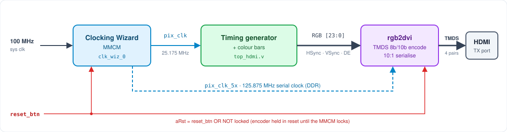

# HDMI Colour Bar Generator on a Zynq-7000 FPGA

Video output over HDMI built from the ground up in Verilog. The design generates standard 640 × 480 @ 60 Hz timing, draws eight colour bars, and drives a monitor through the board's HDMI port using TMDS (DVI-D) encoding.

## Features

- 640 × 480 @ 60 Hz timing (800 × 525 total, 25.175 MHz pixel clock)
- Eight 80-pixel-wide vertical colour bars: red, green, blue, yellow, cyan, magenta, white, black
- Pixel clock and 5× serial clock (125.875 MHz) generated by a Clocking Wizard MMCM from the 100 MHz board clock
- TMDS 8b/10b encoding and serialisation with the Digilent `rgb2dvi` IP, fed by the external 5× clock
- Reset button that holds the TMDS encoder in reset until the MMCM reports lock
- Works with any standard HDMI monitor (DVI-D compatible signalling)

## Architecture

| File | What it does |
|---|---|
| `top_hdmi.v` | Top level: horizontal/vertical counters, sync and data-enable generation, colour-bar pattern, `rgb2dvi` instance |
| `clk_wiz_0.xci` | Clocking Wizard configuration for the pixel and 5× serial clocks |
| `rgb2dvi/` | Digilent TMDS encoder and serialiser IP |
| `hdmi_colour_bars.xdc` | Pin and clock constraints (100 MHz clock, reset button, HDMI TX pairs, HPD, output enable) |

### Video timing

| | Visible | Front porch | Sync | Back porch | Total |
|---|---:|---:|---:|---:|---:|
| Horizontal (pixels) | 640 | 16 | 96 | 48 | 800 |
| Vertical (lines) | 480 | 10 | 2 | 33 | 525 |

Sync, data-enable and colour outputs are all registered on the pixel clock, so they arrive at the encoder aligned with each other.

## Building and running

1. Create a Vivado project for the Zynq-7000 part (`xc7z007s`) and add `top_hdmi.v` and `hdmi_colour_bars.xdc`.
2. Add `rgb2dvi/` to the IP repository (Settings → IP → Repository) and add the `clk_wiz_0.xci` core.
3. Set `top_hdmi` as the top module, then run synthesis, implementation and bitstream generation.
4. Program the board, connect an HDMI monitor, and press the reset button if the picture doesn't appear.

## What I learned

- How DVI/HDMI carries video: TMDS encoding, 10:1 serialisation and why the serial clock is 5× the pixel clock (DDR)
- Generating related clocks with an MMCM and gating reset on `locked`
- Writing a timing generator against a published video standard
